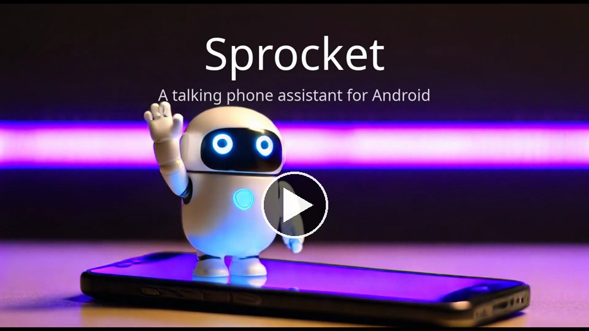
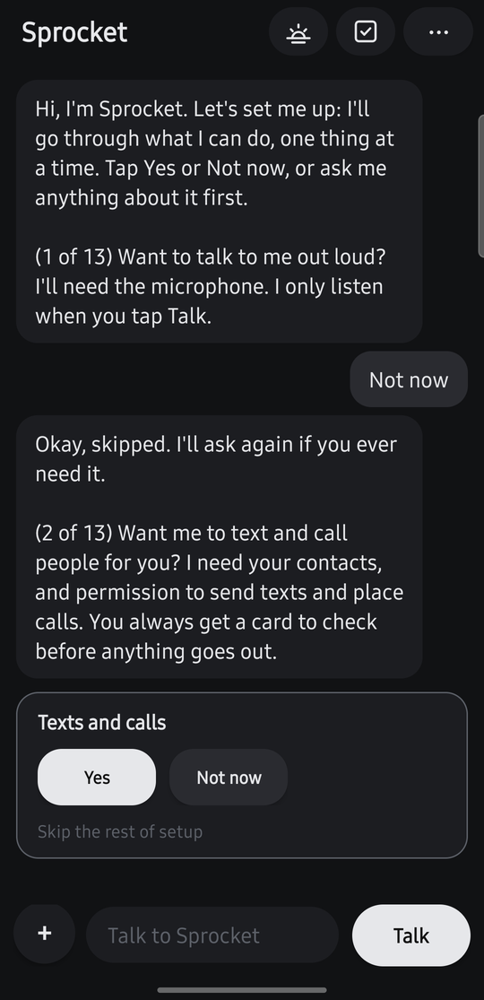
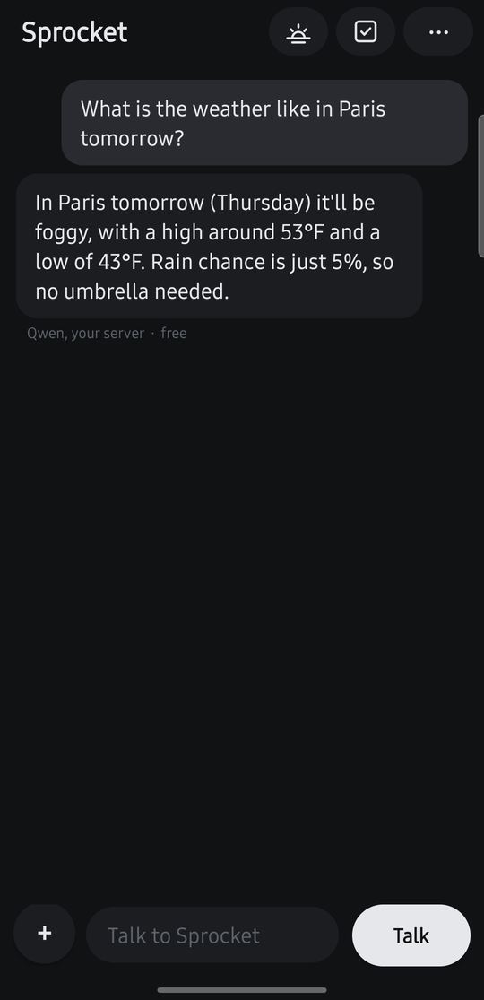
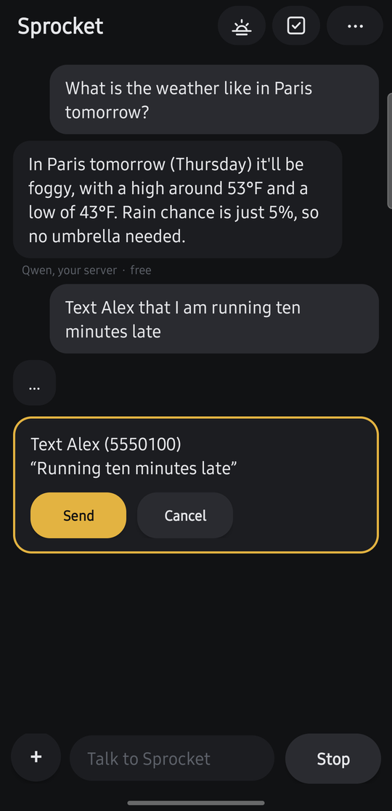
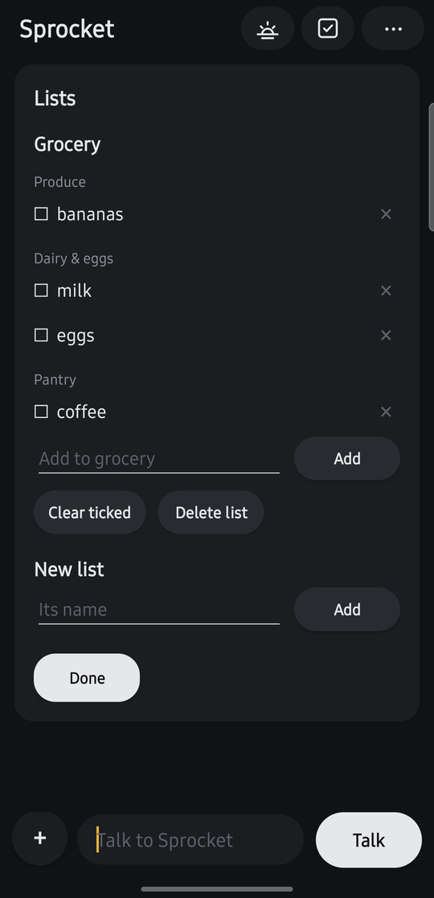

# Sprocket

A talking phone assistant for Android. You talk or type; Sprocket answers out loud and does things on your phone.
It starts out friendly and plain, and its personality is yours to write in Settings > Personality, which comes
with an example to start from: a loud little robot who is sure he was built for war and now sets your timers.

## See it
[](docs/demo.mp4)

| Setup, one feature at a time | Answers out loud | Texts wait for your yes | Lists, sorted by aisle |
|:---:|:---:|:---:|:---:|
|  |  |  |  |

## Why I built it
I wanted a phone assistant that didn't send everything I say to a company's servers. Sprocket started out on Claude,
and I moved it to a model running on my own computer at home, so my questions, texts and notes stay private. You can
run it the same way, or use Claude if you'd rather. On your own model, nothing leaves your own machines except what
goes to the services you choose to connect (web search, the weather, Notion, GitHub).

> **Status:** a personal project, made public as-is. Tested on one Samsung Android phone, with Claude and with
> Qwen through the included go-between. Other models may work (see "Brains"). Not on the Play Store: download it
> from this page instead (see "Install").

## What it does
- **Everyday phone jobs:** timers, alarms, reminders, calendar, contacts, music, maps, the flashlight, volume,
  brightness, Do Not Disturb, the camera and photos.
- **Texts and calls:** reads your texts to you, writes replies, places calls. Nothing is sent or called until you tap
  (or say) yes on a card that shows exactly what will happen.
- **Screen control:** for anything else, Sprocket reads the screen and taps through other apps like a person. Buttons
  like pay, buy, delete, install or sign out wait for your yes; banking, wallet and password apps are off limits.
- **Call announcer:** with the phone on vibrate, it says who is calling and listens for "answer", "decline" or
  "text". Works over the lock screen. You set the hours.
- **Lists:** groceries sorted by aisle, to-dos with due dates, lists from a photo of a recipe, and (optionally) kept
  in Notion so you can edit them on a computer.
- **Morning brief** at 6 am: weather, calendar, what's due, and news on topics you pick.
- **Also:** memory you can see and edit, web search, research write-ups, GitHub threads and repositories (read only).

Every feature can be switched off in Settings.

## Brains
Sprocket speaks Anthropic's Messages API.
- **Claude:** paste your own Claude API key. To get one: sign in at
  [console.anthropic.com](https://console.anthropic.com), add a little credit under **Billing** (and a monthly limit
  under **Limits**, if you like), then **API keys > Create key**. A Claude.ai subscription doesn't include this: the
  API is paid separately, for what you use. Sprocket's first screen has these steps and a button to the Console.
- **Your own model:** point Settings at any server that speaks the Messages API. The included
  [go-between](go-between/) (a small Python server) translates for any OpenAI-compatible server (llama.cpp, vLLM,
  Ollama and others) and adds web search through your own Brave Search key. Tested with Qwen.

## Voices (optional)
- **Speaking:** the phone's own voice by default. Or run a voice server that takes `POST /speak {"text", "mood"}` and
  returns audio; `gateway/voice_server.py` is the one used here, shared as an example to adapt (it needs IndexTTS and a voice
  recording of your own: see `gateway/README.md`, which also has IndexTTS's licence).
- **Listening:** the phone's own recognizer by default. Or any OpenAI-style `/v1/audio/transcriptions` server
  (whisper.cpp's server works).

## Install
1. On your phone, open the [latest release](https://github.com/christopherrobertbrooks-tech/sprocket-assistant/releases/latest) and download
   `sprocket-<version>.apk` (Android 8 or newer).
2. Open the downloaded file and tap **Install**. Android asks once to let your browser install apps: allow it. Google
   Play Protect may warn about an app from outside the Play Store; that's expected here.
3. Open Sprocket: pick its brain on the first screen, and it walks you through the rest in the chat, asking about
   each feature (you can ask it questions along the way). Using your own model? See "Running it on your own model" below.

Updates install the same way, over the top, keeping your chat and lists. A copy you build yourself is signed with your
own key instead, so it can't update a downloaded one (or the other way round) without uninstalling first.

### Build it yourself
You need the Android SDK (platform 35, build-tools 35.0.0) and a JDK 17 or newer. No Gradle.
```
ANDROID_HOME=/path/to/sdk android/build.sh      # makes android/build/sprocket.apk (and a signing key, once)
adb install android/build/sprocket.apk
scripts/test.sh                                  # the plain-Java tests, on your computer
```
Then open Sprocket as in step 3 above.

**Using a coding agent?** Claude Code, Codex or Gemini CLI can do all of this for you: open this folder in it and say
"set up Sprocket on my phone". The steps it follows are in [AGENTS.md](AGENTS.md).

## Running it on your own model
1. Start a model server on your computer. New to this? Install [Ollama](https://ollama.com) and `ollama pull` a
   model that [supports tools](https://ollama.com/search?c=tools), as big as your graphics card holds.
2. Download this repository (on GitHub: **Code > Download ZIP**, then unzip it) and run `python3 go-between/start.py` (Python 3, nothing else to install). It finds your
   model server, makes an access code, and prints exactly what to type into Sprocket.
3. In Sprocket, tap **Your own server**, type what it printed, and tap **Start**. Sprocket tests the connection first
   and says plainly what's wrong if it can't get through.

The phone has to reach that computer: `start.py` prints the Tailscale command if you have Tailscale; otherwise see
below.

## Reaching your own server
Only needed for your own model (or the optional voice servers): with Claude, the phone talks to Anthropic directly.
Your phone has to be able to reach the computer running the [go-between](go-between/). Three ways, easiest first:

**1. Tailscale (recommended: works anywhere, encrypted, free for personal use)**
1. Install Tailscale on the computer (tailscale.com/download) and the Tailscale app on your phone (Google Play).
   Sign in to the same account on both.
2. On the computer, give the go-between a secure address on your Tailscale network:
   `tailscale serve --bg --https=8448 http://127.0.0.1:8048`
   (the first time, Tailscale may ask you to turn on HTTPS certificates in its admin page: say yes).
3. In Sprocket, the address is `https://<computer-name>.<your-tailnet>.ts.net:8448`. Both names are in the
   Tailscale app, under the computer.

**2. A tunnel (an https address on the internet, no Tailscale app on the phone)**
Cloudflare's free `cloudflared` is one: install it on the computer, then
`cloudflared tunnel --url http://localhost:8048` prints an `https://....trycloudflare.com` address to use in
Sprocket. That quick address changes every time it restarts; a permanent one needs a free Cloudflare account and a
domain of your own (see Cloudflare's "Tunnel" guide). A tunnel puts the go-between on the open internet, so its
access code is the only lock: make it long and random.

**3. Your home network (simplest, but only at home)**
Start the go-between with `python3 go-between/start.py --home`, which prints the computer's home address (for example
`http://192.168.1.50:8048`) to use in Sprocket. It stops working when the phone leaves your Wi-Fi,
and it isn't encrypted: anyone else on that network could read what you ask, and the access code.

Sprocket accepts `https://` addresses anywhere, and plain `http://` only for Tailscale and home-network addresses.

## Questions, ideas and the roadmap
- **Questions:** [Discussions > Q&A](../../discussions/categories/q-a).
- **Ideas:** [Discussions > Ideas](../../discussions/categories/ideas). What's planned, maybe, and not planned is in
  [ROADMAP.md](ROADMAP.md).
- **Bugs:** [Issues](../../issues/new/choose), through the bug form.
- **Helping out:** see [CONTRIBUTING.md](CONTRIBUTING.md).

It's a personal project, so answers may take a while.

## Privacy
- Your keys stay on your phone. Your chat, memory and lists stay on your phone (and in your own Notion, if you
  connect it).
- What you ask goes to the brain you chose: Anthropic for Claude, or your own server.
- Weather comes from Open-Meteo, GitHub from GitHub's public API, lists from your Notion when connected. Web search
  goes through Anthropic's search (Claude) or the go-between's Brave Search (your own model).
- Nothing is collected by anyone else. There are no analytics.

## Be careful
Screen control and auto-answering calls are powerful. Sprocket asks before anything that sends, calls, buys or
deletes, but it is an AI and can misread a screen. Keep an eye on it the first few times, and switch off what you
don't want.

## Credits
- Weather data by [Open-Meteo.com](https://open-meteo.com/) (CC BY 4.0); place names from GeoNames.
- Sprocket is not affiliated with Anthropic, Notion, GitHub, Brave or any model maker.
- Written with Claude (Anthropic's AI) as the programmer, directed and tested by its owner.

## Licence
MIT (see [LICENSE](LICENSE)). The optional voice server in `gateway/` uses IndexTTS, which has its own licence:
see `gateway/README.md`.
